# AyroX sim2real target process

**AyroX's hybrid drone flies the real NUST H-12 campus, entirely in simulation.** This repo is a working Isaac Sim pipeline for the [AyroX Synthetic Data Drone Study](STUDY.md). The drone flies from a start point to a goal 70–150 m away at 5 m above the local ground, past real buildings, trees and power lines plus per-flight clutter. Every flight is logged as synthetic training data, and the same harness measures success on new layouts, on a campus never trained on (UET Taxila), and in conditions harsher than training.

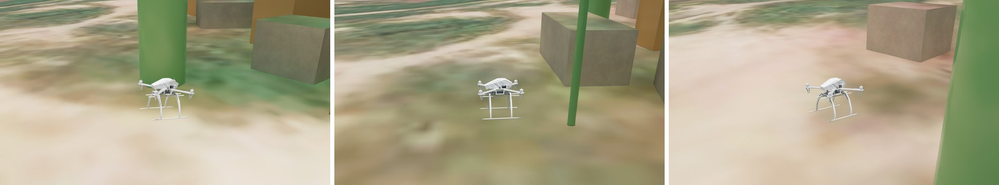

<sub>Isaac Sim 6.0.1, chase camera on `nust_train_varied #3`, at 15%, 45% and 75% of the way to the goal. Textured buildings and satellite terrain are from the NUST twin. The tan crates and green poles were added to this flight only.</sub>

---

## Two stages

| Stage | World | Drone | Status |
|---|---|---|---|
| **1. Pipeline** | Procedural 260 m campus (generated) | Crazyflie `cf2x` (NVIDIA asset) | ✅ built, 150 training flights, evaluated |
| **2. The study's setup** | **NUST H-12 and UET Taxila digital twins** (3 km × 3 km, real OSM / Microsoft building footprints, terrain, trees, power lines) | **AK hybrid drone** (AyroX's 1.5 kg quad, from its Gazebo model) | ✅ converted to Isaac Sim, 250 training flights, evaluated |

Both stages share the same code: the flight stack, randomization, sensing, expert, dataset format and evaluator. The world and the drone are chosen per split in [`config.py`](sim2real_target/config.py).

## The campus twins in Isaac Sim

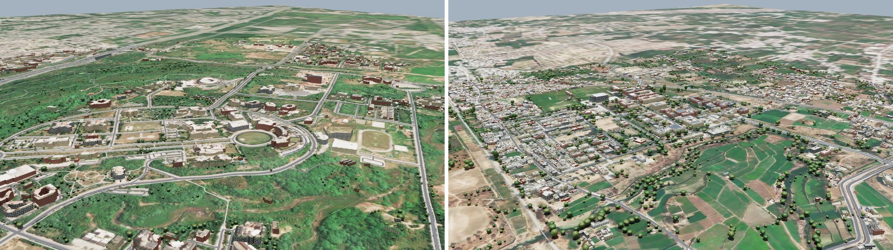

<sub>Left: NUST H-12, Islamabad (training campus). Right: UET Taxila (test only, never trained on). Both are converted from AyroX's Gazebo world package by [`tools/build_twins.py`](sim2real_target/tools/build_twins.py).</sub>

| Twin | Modelled area | Buildings | Trees | Power-line supports | Triangles (terrain / obstacles) | Used for |
|---|---|---|---|---|---|---|
| NUST H-12 | 3.0 × 3.0 km | 3,070 | 2,888 | 136 | 182 k / 213 k | training + 2 test splits |
| UET Taxila | 2.0 × 2.5 km | 6,568 | 3,575 | 72 | 102 k / 501 k | unseen-campus test |

**How the twins get into Isaac Sim:**
1. **Convert.** Every DAE tile (6 × 6 tiles of 500 m for NUST) goes through Isaac's asset converter. The tiles are assembled into one USD per campus, with static triangle-mesh colliders on the terrain, buildings, trees and power lines.
2. **Map.** The same triangles are rasterized into a 1 m map of terrain height and obstacle heights ([`tools/build_maps.py`](sim2real_target/tools/build_maps.py)). The expert plans on this map at 5 m above the local ground.
3. **Simulate.** Sensing and crash detection run against the full meshes in PhysX, not the map.

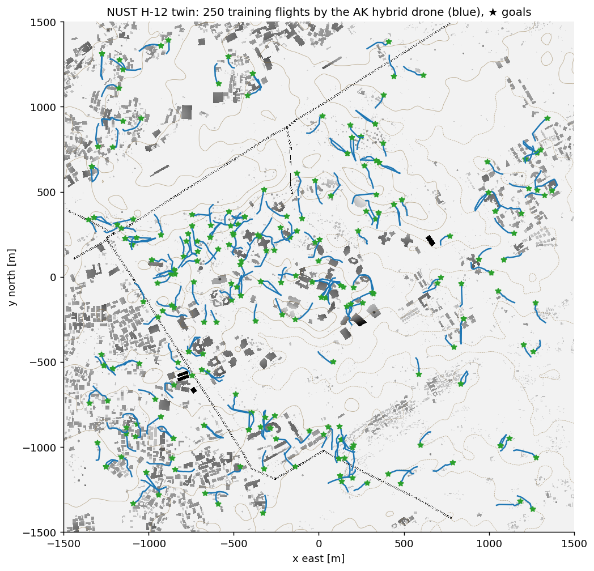

## What we built

| Step | What it does | Code |
|---|---|---|
| 1. **World** | The NUST / UET Taxila twins (stage 2), or a procedural campus (stage 1). Per flight, 8–28 extra obstacles are placed on the terrain around the route. | [`twin.py`](sim2real_target/twin.py), [`campus.py`](sim2real_target/campus.py) |
| 2. **Drone** | The AK hybrid drone: 1.5 kg, I = diag(0.037, 0.04, 0.07) kg·m² from its SDF, frame and props from its meshes. It is driven by a velocity → attitude → thrust/torque flight stack, and the policy outputs velocity setpoints, the interface a flight controller exposes on the real drone. | [`controller.py`](sim2real_target/controller.py), [`env.py`](sim2real_target/env.py) |
| 3. **Randomization** | Each flight draws its own clutter, wind and gusts, sensor noise, mass, thrust gain, motor lag and command latency. | [`config.py`](sim2real_target/config.py) |
| 4. **Onboard sensing** | Noisy position and velocity estimates, a downward height sensor, and a 16-beam horizontal range ring of PhysX raycasts against the real meshes. A student policy sees only this. | [`env.py`](sim2real_target/env.py) |
| 5. **Expert pilot** | A* on the inflated twin map plus pure pursuit, holding 5 m above the terrain. It uses the true map and state, playing the "pilot" from the study. | [`expert.py`](sim2real_target/expert.py) |
| 6. **Dataset + evaluation** | 10 Hz logs of observation, action, expert label and ground truth. Success is measured on held-out splits. | [`generate_dataset.py`](sim2real_target/generate_dataset.py), [`evaluate.py`](sim2real_target/evaluate.py) |

```
flight seed ─► start/goal on the twin · clutter · wind · noise · drone response
                   │
   expert (twin map + true state) ── velocity setpoint @10 Hz ──► flight stack @100 Hz ──► PhysX hybrid drone
                   │                                                                              │
   logged: onboard observation (noisy) + action + expert label + ground truth  ◄─────────────────┘
```

## Clean vs varied vs harsh

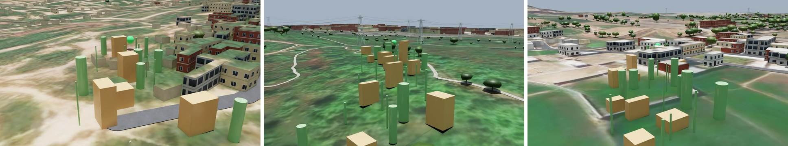

<sub>Left to right: `nust_train_varied #3`, `nust_test_harsh #0` (28–40 extra obstacles, stronger wind and noise), `taxila_test_unseen #1` (UET Taxila, never trained on). The green sphere is the 2 m goal.</sub>

| Per flight | clean | varied (train) | harsh (stress test) |
|---|---|---|---|
| Extra obstacles | 0 | 8–28 | 28–40 |
| Mean wind | 0 | 0.2–1.1 m/s | 1.1–1.8 m/s |
| Sensor noise | 0 | 4–11 cm | 11–16 cm |
| Mass / thrust gain | ×1.0 / ×1.0 | ×0.9–1.1 / ×0.88–1.12 | ×0.85–1.15 / ×0.82–1.18 |
| Motor lag / latency | 25 ms / 0 | 15–40 ms / 0–200 ms | 40–60 ms / 100–300 ms |

## Results

All numbers below come from flights run in this repo.

### One flight in the NUST twin

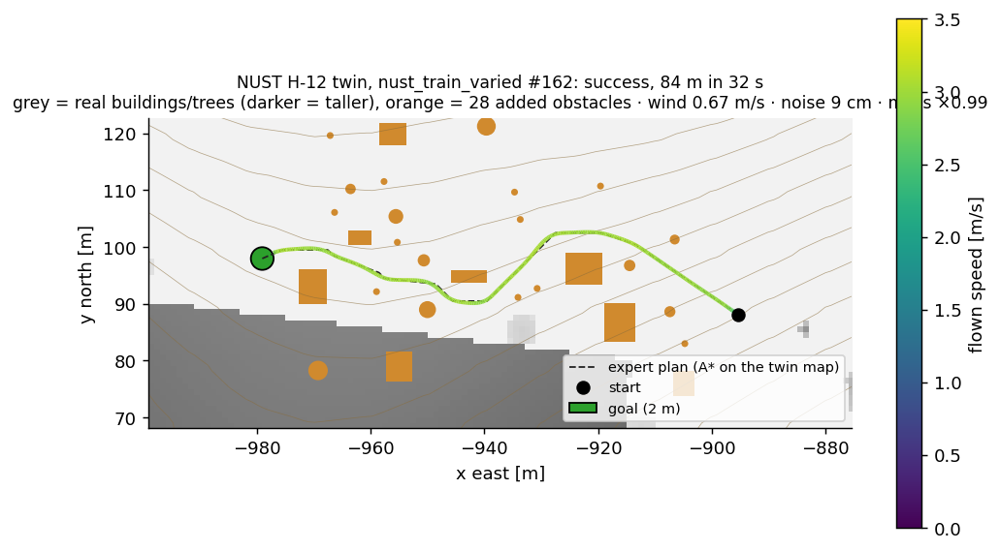

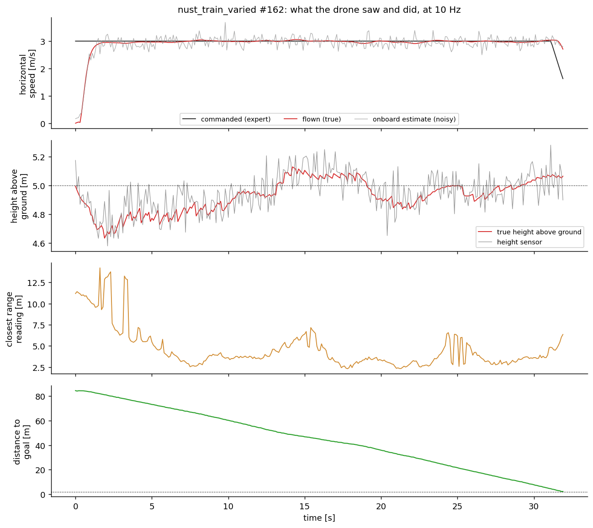

| Range ring at the closest pass | Unseen campus: UET Taxila test routes |
|---|---|
| 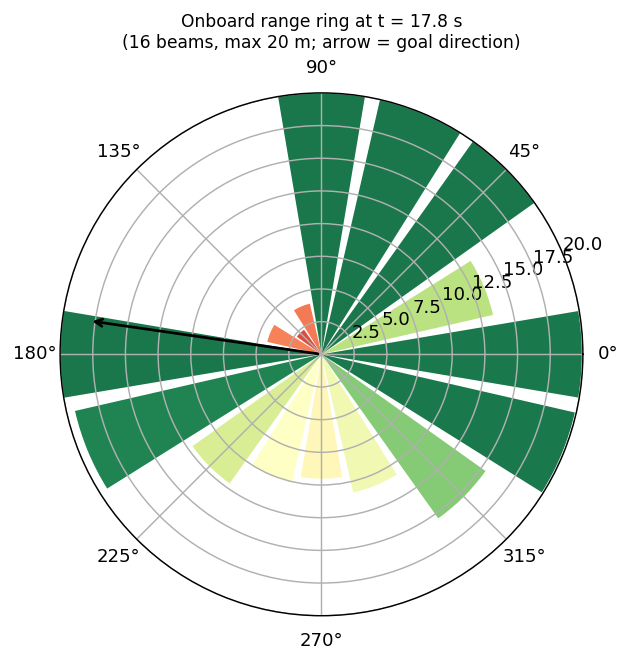 | 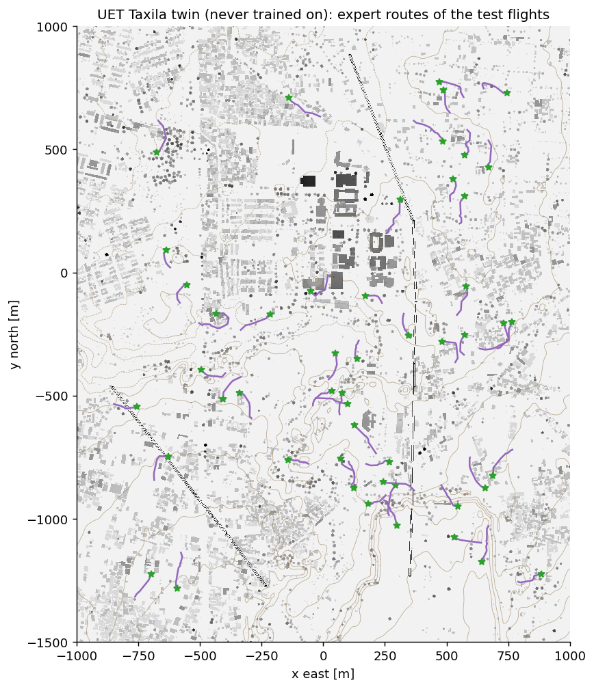 |

### Expert baseline

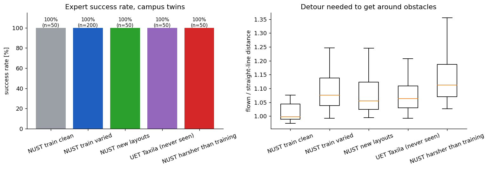

<!-- RESULTS_TABLE -->
| World · drone | Split | Flights | Expert success |
|---|---|---|---|
| Procedural campus · Crazyflie | train clean | 50 | 100% |
| Procedural campus · Crazyflie | train varied | 100 | 100% |
| Procedural campus · Crazyflie | new layouts | 25 | 100% |
| Procedural campus · Crazyflie | unseen campus | 25 | 100% |
| Procedural campus · Crazyflie | harsher than training | 25 | 100% |
| NUST / UET Taxila twins · AK hybrid | NUST train clean | 50 | 100% |
| NUST / UET Taxila twins · AK hybrid | NUST train varied | 200 | 100% |
| NUST / UET Taxila twins · AK hybrid | NUST new layouts | 50 | 100% |
| NUST / UET Taxila twins · AK hybrid | UET Taxila (never seen) | 50 | 100% |
| NUST / UET Taxila twins · AK hybrid | NUST harsher than training | 50 | 100% |

Synthetic dataset: **400 flights, 4.5 h, 48.3 km flown**, 0 real flights. Exact numbers are in [`summary.json`](sim2real_target/docs/figures/summary.json).
<!-- /RESULTS_TABLE -->

The expert is the privileged teacher, so its score is the upper bound a student policy is measured against. In the study, the pilot scored 99–100%.

<details>
<summary><b>Stage 1: procedural campus with the Crazyflie (figures)</b></summary>

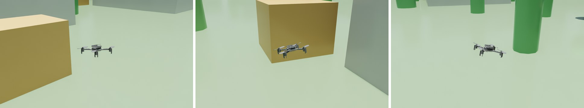
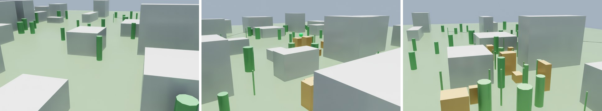
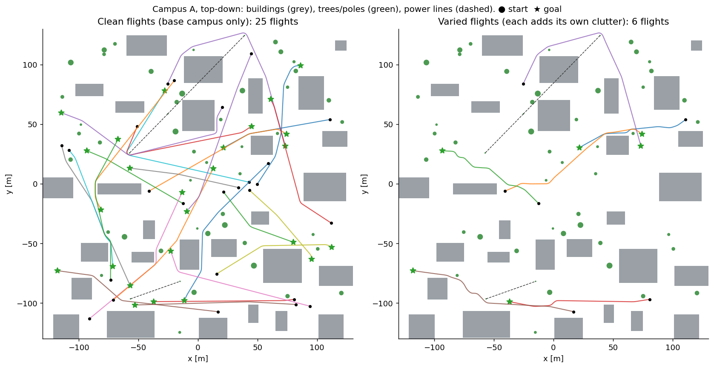

| One varied flight | One clean flight |
|---|---|
| 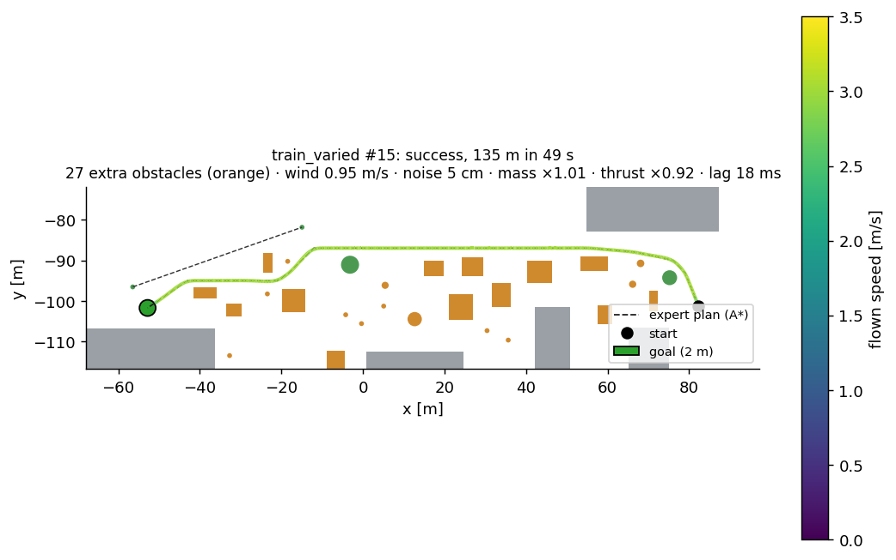 | 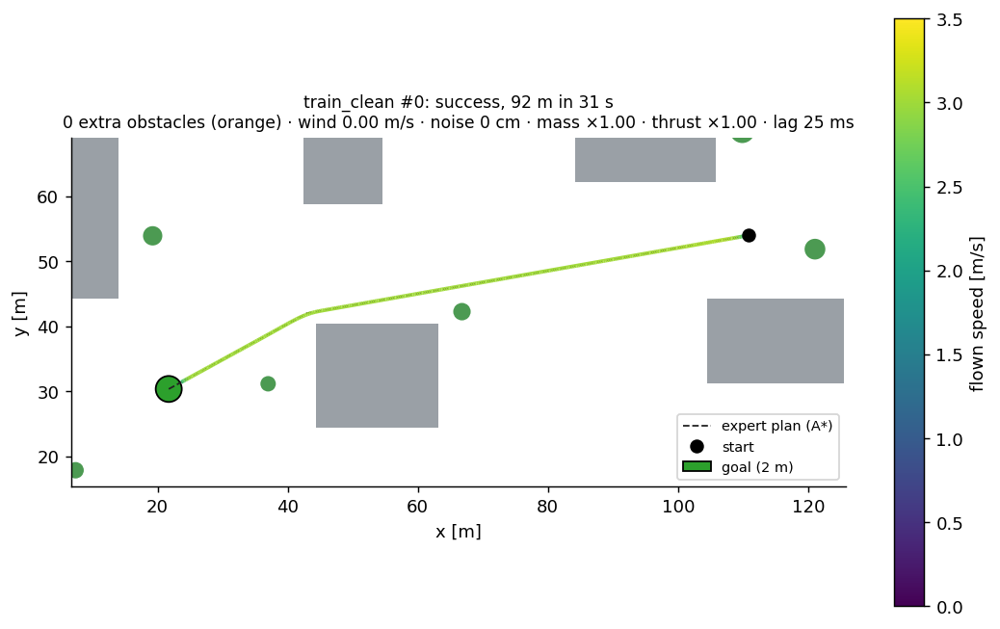 |

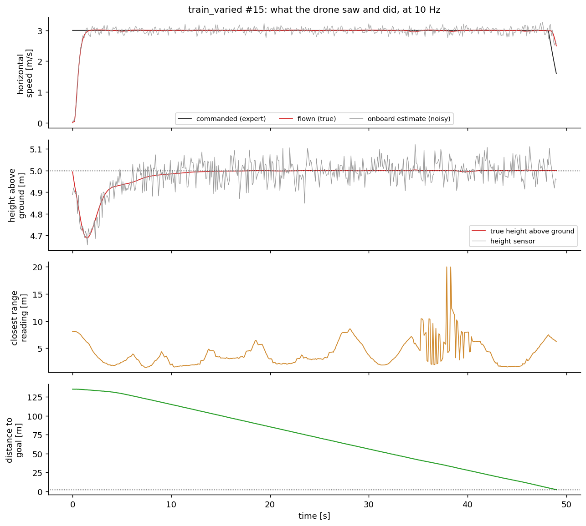
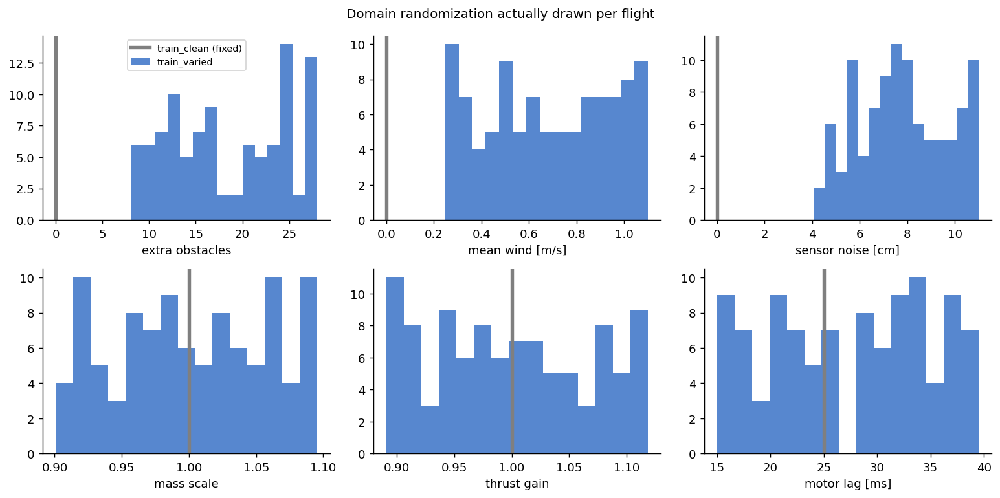
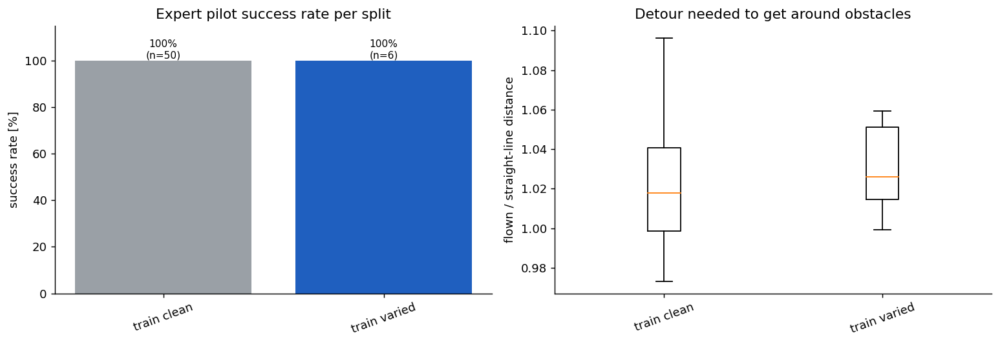

</details>

## Engineering notes

- **Gazebo → Isaac Sim.** The converter writes a Y-up stage tag on Z-up geometry, so every tile's tag is corrected. Colliders are authored as overrides on the referenced meshes. The SDF's `ak_hybrid_quadron` has zero inertia, so the drone uses the mass and inertia of `hybrid_drone_backtrack`, the model placed in the NUST world, which shares its meshes.
- **Altitude follows the terrain.** NUST's ground spans about 78 m of relief. Start, goal, clutter, the expert's height target and the success check all use height above the local ground.
- **Crashes against the real meshes.** On the twins, a PhysX overlap sphere around the drone reports what it touches, so terrain counts as a ground crash and everything else as an obstacle crash.
- **Thin-pole bug, found and fixed.** A 0.3 m pole could fall between 1 m cell centres and vanish from the planner's map, and the expert flew straight into it. Clutter is now rasterized with half a cell diagonal of padding before the 1.6 m safety margin.
- **The grey sheet in early renders was the viewport grid.** Kit draws its reference grid at z = 0, and NUST's terrain dips up to 33 m below that, so the grid covered every low-lying area. GUI runs now switch the grid off.
- **Sensors must start outside the drone.** The range and height rays started 0.12 m from the drone's centre, which clears the 10 cm Crazyflie but is inside the hybrid drone's 0.36 m frame. Every reading came back near 0 m. Success rates were unaffected, because the expert flies on the true map, but the logged observations were wrong. Rays now start just outside the drone's radius, the twin training data was regenerated, and dataset generation warns if the height reading ever collapses.
- **Reproducible flights.** Everything about a flight is drawn from `(campus_seed, flight_seed)`. The figures rebuild each flight's clutter and expert route without Isaac Sim.
- **No state leaks between flights**, and **3× faster** physics stepping through the PhysX tensor view. Twin flights run at about 2.4× real time on an RTX 3080 Laptop GPU.
- **Long-running processes and memory.** After about 85 flights in one Isaac process, the RTX renderer fails with `Out of resource descriptors` and the process hangs, even headless. [`run_sharded.sh`](sim2real_target/run_sharded.sh) therefore restarts Isaac every 40 flights and splits a split across parallel processes. On a 31 GB machine, keep it to two or three processes at about 5–6 GB each; more caused out-of-memory kills.

## Scaling: many drones at once on the GPU

Today each process flies one drone with CPU physics, about 15–20 s of wall time per flight. [`tools/gpu_benchmark.py`](sim2real_target/tools/gpu_benchmark.py) checks whether this machine can fly many at once instead. It loads the NUST twin once with N hybrid drones, runs PhysX on the GPU with batched forces and state readback every step, and casts the 17 sensor rays per drone with Warp against the twin's 395 k triangles.

| Drones | Physics steps/s | Drone-steps/s | GPU memory | Sensor rays (17 per drone) |
|---|---|---|---|---|
| 1 | 176 | 176 | 2.4 GB | 0.19 ms |
| 16 | 184 | 2,950 | 2.6 GB | 0.16 ms |
| 64 | 164 | 10,520 | 2.6 GB | 0.15 ms |
| 256 | 117 | **30,020** | 2.6 GB | 0.15 ms |
| 1,024 | out of system RAM (about 18 GB, killed) | | | |

On an RTX 3080 Laptop (16 GB) with 31 GB of RAM, 256 parallel drones give about 125× today's throughput; system RAM is the limit, not the GPU. A vectorized env, with the controller, expert and sensors batched and physics-only drones, is the next engineering step.

## Reproduce

Requires Isaac Sim 6.0.1 standalone (`~/Documents/isaacsim`) and AyroX's `ak_hybrid_drone` Gazebo package. The package is not in this repo; it is about 220 MB compressed.

```bash
cd sim2real_target
~/Documents/isaacsim/python.sh tools/build_twins.py --src ~/Documents/ak_hybrid_drone_src/ak_hybrid_drone   # twins + drone -> assets/
python3 tools/build_maps.py                                       # planning maps -> assets/twins/*_map.npz
~/Documents/isaacsim/python.sh generate_dataset.py --gui --split nust_train_varied --flights 3   # watch it fly
VARIED=300 EVAL=200 bash run_twin_study.sh                        # twin datasets + expert evaluation
~/Documents/isaacsim/python.sh capture_showcase.py --shots nust_train_varied:3,nust_test_harsh:0,taxila_test_unseen:1
bash run_sharded.sh nust_train_varied 0 3000 3                    # big datasets: 3 parallel processes, Isaac restarted every 40 flights
python3 make_figures.py                                           # figures + this README's results table
```

The technical README, covering the observation layout, dataset format, student-policy API and current limits, is at [`sim2real_target/README.md`](sim2real_target/README.md).

## Next

1. **Behaviour cloning on the twin data**: train one student on `nust_train_clean` and one on `nust_train_varied`, using onboard observations only, then compare them on new NUST layouts, UET Taxila and harsh NUST. This is the study's "variety vs volume" experiment.
2. **Corrections (DAgger)**: let the student fly, then train on the logged `expert_action` labels.
3. **Hardware**: send the student's velocity setpoints to the real AK hybrid drone in a controlled space, then fly campus routes and compare them flight for flight with the twin.

---

**AyroX**: simulation-first infrastructure for embodied AI · [ayrox.tech](https://ayrox.tech)
