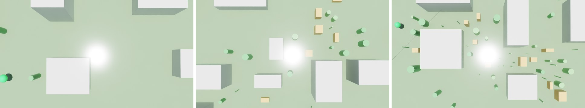
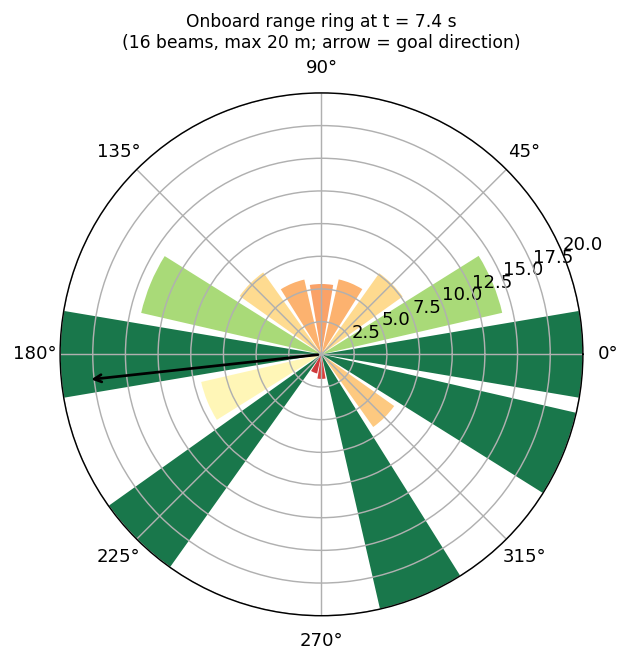

# AyroX sim2real target process

**A Crazyflie learns where to go, entirely in simulation.** This repo is a small, working Isaac Sim pipeline for the [AyroX Synthetic Data Drone Study](STUDY.md). It flies a drone from a start point to a goal 70–150 m away at 5 m above the ground, through a randomized campus. Every flight is logged as synthetic training data, and the same harness measures success on layouts, campuses and conditions the training data never covered.


<sub>Isaac Sim 6.0.1, chase camera on `train_varied #11`, at 15%, 45% and 75% of the way to the goal. The orange crates were added to this flight only.</sub>

---

## What we built

| Step | What it does | Code |
|---|---|---|
| 1. **Campus** | A procedural 260 m × 260 m campus with 28 buildings, about 45 trees and 2 power lines. A second campus is generated from another seed and used only for testing, in the role of the study's UET Taxila twin. | [`campus.py`](sim2real_target/campus.py) |
| 2. **Drone** | NVIDIA's Crazyflie `cf2x` USD, driven through a velocity → attitude → thrust/torque flight stack. The policy outputs velocity setpoints, the same command the real Crazyflie takes through `cflib`. | [`controller.py`](sim2real_target/controller.py), [`env.py`](sim2real_target/env.py) |
| 3. **Randomization** | Every flight draws its own clutter (8–28 extra obstacles), wind and gusts, sensor noise, mass, thrust gain, motor lag and command latency. | [`config.py`](sim2real_target/config.py) |
| 4. **Onboard sensing** | A noisy position and velocity estimate, a downward height sensor, and a 16-beam horizontal range ring made of PhysX raycasts. This is all a student policy ever sees. | [`env.py`](sim2real_target/env.py) |
| 5. **Expert pilot** | A* on an inflated occupancy grid plus pure pursuit. It uses the true map and true state, playing the "pilot" from the study. | [`expert.py`](sim2real_target/expert.py) |
| 6. **Dataset + evaluation** | 10 Hz logs of observations, actions, expert labels and ground truth. The evaluator reports success rates on held-out splits. | [`generate_dataset.py`](sim2real_target/generate_dataset.py), [`evaluate.py`](sim2real_target/evaluate.py) |

```
flight seed ─► layout · start/goal · wind · noise · drone response
                   │
   expert (true map + state) ── velocity setpoint @10 Hz ──►  flight stack @100 Hz ──► PhysX Crazyflie
                   │                                                                        │
   logged: onboard observation (noisy)  +  action  +  expert label  +  ground truth  ◄───────┘
```

## Clean vs varied vs harsh

The same pipeline produces the three conditions in the study. **Clean** uses only the fixed campus: no extra obstacles, no wind, no noise, nominal drone. **Varied** is the training distribution. **Harsh** goes beyond the training ranges.




<sub>Left to right: `train_clean #0`, `train_varied #11`, `test_harsh #0`. The green sphere is the 2 m goal. Grey: campus buildings. Green: trees and poles. Orange: per-flight clutter.</sub>

| Per flight | clean | varied (train) | harsh (stress test) |
|---|---|---|---|
| Extra obstacles | 0 | 8–28 | 28–40 |
| Mean wind | 0 | 0.2–1.1 m/s | 1.1–1.8 m/s |
| Sensor noise | 0 | 4–11 cm | 11–16 cm |
| Mass / thrust gain | ×1.0 / ×1.0 | ×0.9–1.1 / ×0.88–1.12 | ×0.85–1.15 / ×0.82–1.18 |
| Motor lag / latency | 25 ms / 0 | 15–40 ms / 0–200 ms | 40–60 ms / 100–300 ms |

## Results

All numbers below come from flights run in this repo.

### Flights on the map


| One varied flight in detail | One clean flight in detail |
|---|---|
|  |  |

### What the drone sees and does


| Range ring at the closest pass | Randomization actually drawn |
|---|---|
|  |  |

### Expert baseline


<!-- RESULTS_TABLE -->
| Split | Flights | Expert success |
|---|---|---|
| train clean | 50 | 100% |
| train varied | 6 | 100% |

Synthetic dataset: **56 flights, 0.6 h, 6.6 km flown**, 0 real flights. Exact numbers are in [`summary.json`](sim2real_target/docs/figures/summary.json).
<!-- /RESULTS_TABLE -->

> **Run in progress:** 100 varied training flights, plus 25 expert flights on each of the three test splits (new layouts, unseen campus, harsher than training). This section updates when the run finishes.

The expert is the privileged teacher, so its score is the upper bound a student policy is measured against. In the study, the pilot scored 99–100%.

## Engineering notes

- **Reproducible flights.** Everything about a flight is drawn from `(campus_seed, flight_seed)`, so any flight in the dataset can be replayed exactly. The figures rebuild each flight's obstacle layout this way, without Isaac Sim.
- **No state leaks between flights.** Stopping the timeline while `playSimulations` was off left PhysX un-reset, so flight *n* started where flight *n−1* ended. The reset now forces a real stop and play, then asserts that the drone respawned at the start.
- **3× faster.** The experimental `RigidPrim` wrapper allocates warp arrays on every call. At physics rate, the env calls the PhysX tensor view directly with preallocated buffers. Headless runs go at about 1.6× real time, roughly 20 s of wall time per flight on an RTX 3080 Laptop GPU.
- **Memory.** One Isaac Sim process uses about 6 GB of RAM and stays flat across flights. Run one at a time.

## Reproduce

Requires Isaac Sim 6.0.1 standalone (`~/Documents/isaacsim`) and network access to NVIDIA's asset server for the Crazyflie USD.

```bash
cd sim2real_target
~/Documents/isaacsim/python.sh generate_dataset.py --gui --split train_varied --flights 5   # watch it fly
VARIED=300 EVAL=200 bash make_dataset.sh       # datasets + expert evaluation (headless)
~/Documents/isaacsim/python.sh capture_showcase.py   # Isaac Sim screenshots -> docs/images
python3 make_figures.py                        # figures -> docs/figures (matplotlib, no Isaac needed)
```

The full technical README, covering the observation layout, dataset format, student-policy API and current limits, is at [`sim2real_target/README.md`](sim2real_target/README.md).

## Next

1. **Behaviour cloning**: train a student on `train_clean` and on `train_varied` using onboard observations only, then compare them on the three test splits. This is the study's "variety vs volume" experiment.
2. **Corrections (DAgger)**: let the student fly, then train on the logged `expert_action` labels.
3. **Hardware**: send the student's velocity setpoints to a real Crazyflie through `cflib` in a controlled space.

---

**AyroX**: simulation-first infrastructure for embodied AI · [ayrox.tech](https://ayrox.tech)
